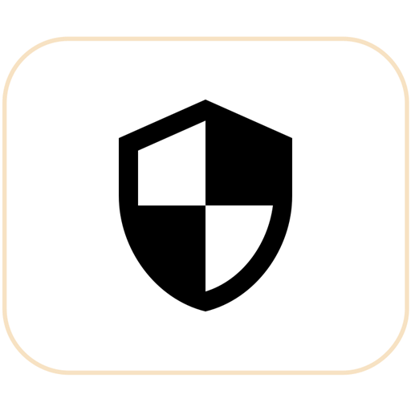
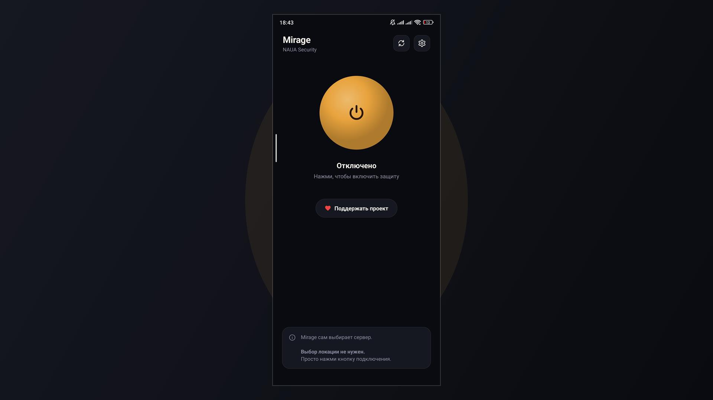
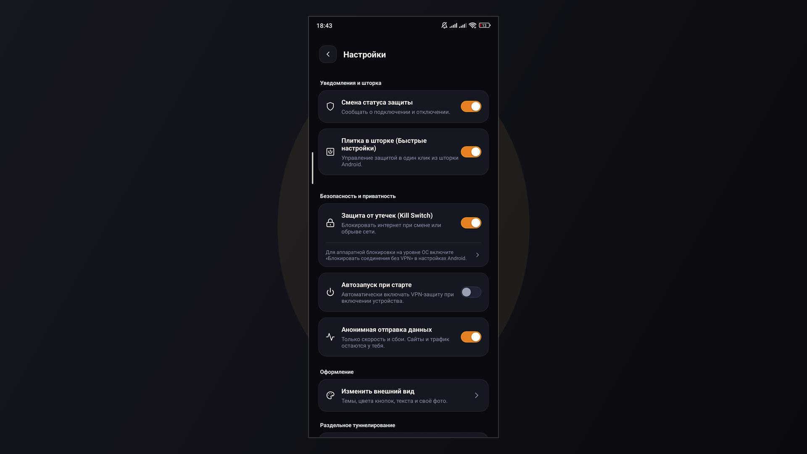
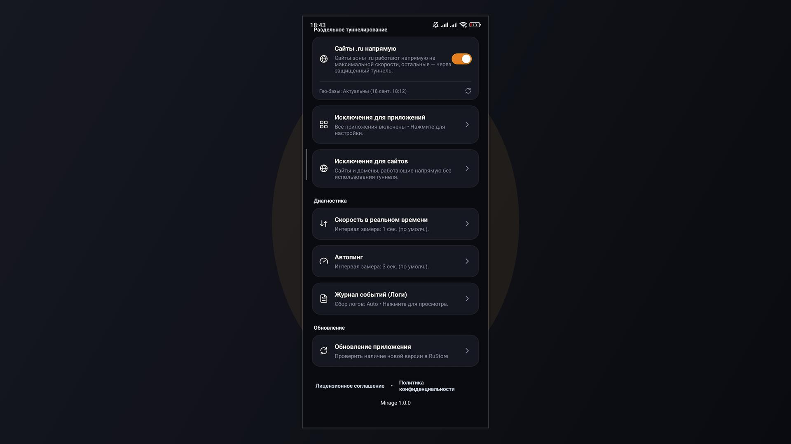
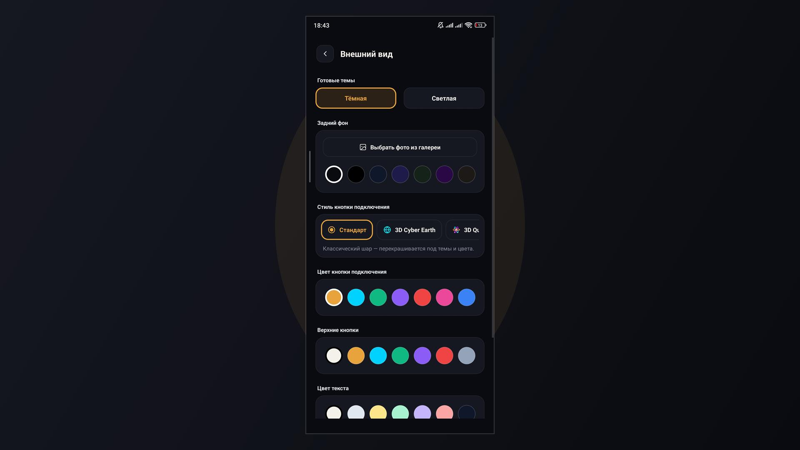
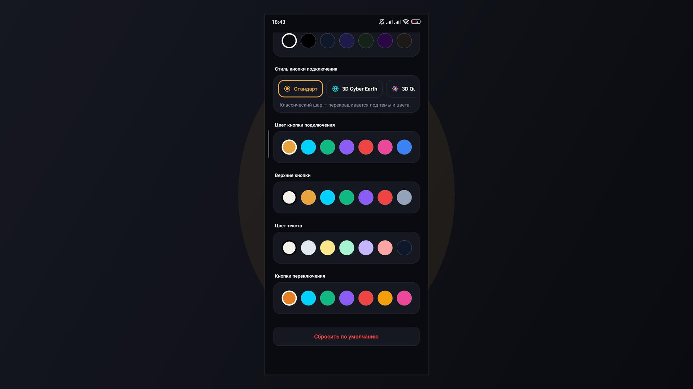
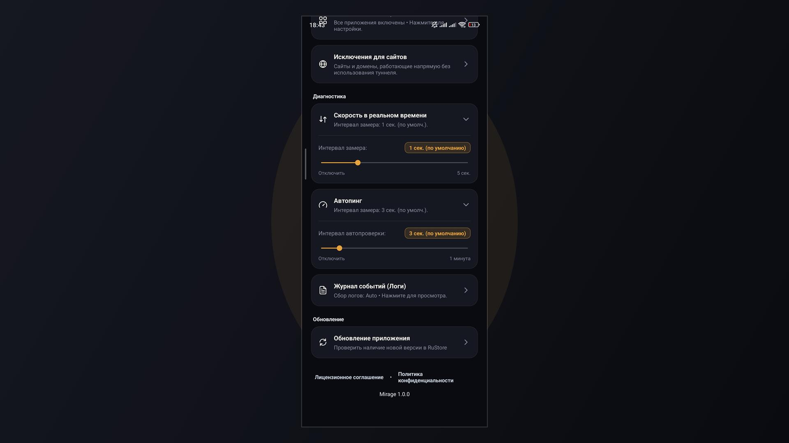
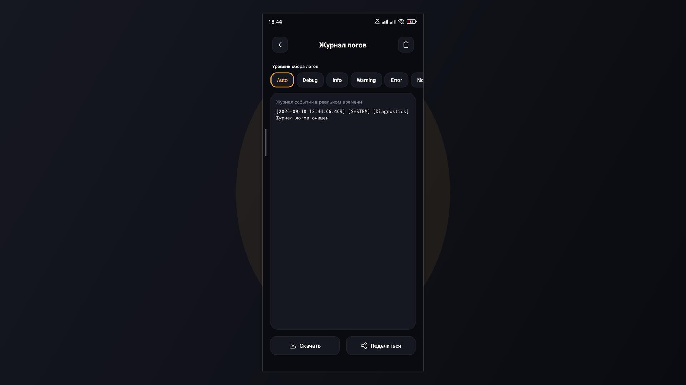
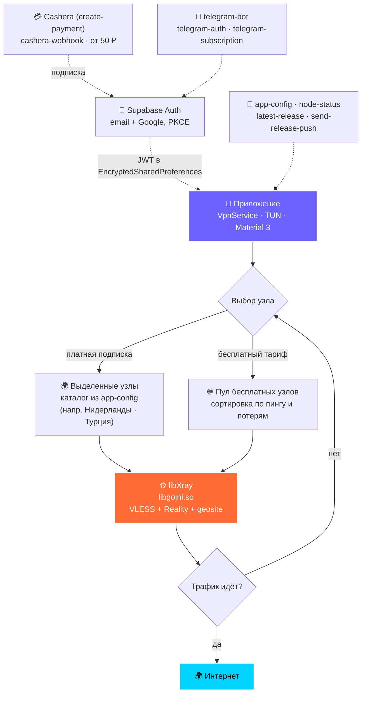

<p align="center">
  
</p>

<p align="center">
  
</p>

<p align="center">
  <b>Нативный Android-VPN на VLESS + Reality: трафик неотличим от обычного HTTPS, туннель поднимается в один тап, рекламы в приложении нет вообще.</b>
</p>

<p align="center">
  <a href="https://github.com/Core-Dev-Support/naua-security-mirage-android/releases/latest"></a>
  <a href="https://github.com/Core-Dev-Support/naua-security-mirage-android/actions/workflows/build-release.yml"></a>
  
  
  
  
</p>

<p align="center">
  <a href="https://github.com/Core-Dev-Support/naua-security-mirage-android/releases/latest"></a>
  &nbsp;&nbsp;
  <a href="https://t.me/News_And_Updates_Apps"></a>
  &nbsp;&nbsp;
  <a href="https://t.me/NAUA_Security_Mirage_Bot"></a>
  &nbsp;&nbsp;
  <a href="README_EN.md"></a>
</p>

<p align="center">
  <sub>Последний релиз: <b>v1.4.0</b> · Android 6.0+ (API 23–35) · <code>arm64-v8a</code> / <code>armeabi-v7a</code></sub>
</p>

<p align="center">
  <a href="#-быстрый-старт">Быстрый старт</a> ·
  <a href="#что-внутри">Возможности</a> ·
  <a href="#-протоколы">Протоколы</a> ·
  <a href="#-экраны">Экраны</a> ·
  <a href="#-как-это-работает">Архитектура</a> ·
  <a href="#-безопасность-и-приватность">Безопасность</a> ·
  <a href="#-вопросы">FAQ</a>
</p>

---

## ⚡ Быстрый старт

1. Скачай `NAUA-Security-Mirage-v1.4.0-arm64-v8a.apk` (или `armeabi-v7a` для старых 32-битных устройств) из [**Releases → Latest**](https://github.com/Core-Dev-Support/naua-security-mirage-android/releases/latest).
2. Установи APK и нажми большую кнопку на главном экране — приложение само выберет лучший узел.
3. Проверь работу туннеля прямо в карточке диагностики или на [ipleak.net](https://ipleak.net) / [dnsleaktest.com](https://dnsleaktest.com).

---

## Что внутри

Одна большая кнопка — и туннель поднят. Локацию выбирать не нужно: клиент сам замеряет пинг, потери и джиттер до всех доступных узлов, поднимает ядро Xray на лучшем и проверяет, что трафик реально идёт, а не просто «ядро стартовало». Если выбранный узел не тянет — происходит автоматический переход на следующий.

**🛡 Маскировка.** VLESS + Reality: соединение неотличимо от обычной TLS-сессии к популярному сайту, поэтому переживает DPI там, где падают протоколы с узнаваемыми сигнатурами.

**⚡ Split-tunneling.** Per-App Proxy, свои домены напрямую, весь `.ru` мимо туннеля на полной скорости.

**🧭 Безопасный старт.** Приложение не запускается на подменённой подписи, root-устройстве, эмуляторе, с подключённым отладчиком или с Frida.

**🔒 DNS внутри туннеля.** Плюс карточка-предупреждение, если системный «Частный DNS» ломает маршрутизацию.

**🔄 Обновление внутри приложения.** Скачивание и установка с обязательной проверкой подписи v2/v3 — чужая подпись отменяет установку.

**📴 Защита экрана.** `FLAG_SECURE`, плюс диалог с объяснением риска, если снять скриншот всё же нужно.

**🧩 Своя панель настроек.** Темы, 5 стилей кнопки, анимации, скрытие и перестановка разделов, русский и английский.

**🤖 Telegram-бот и кроссплатформенная подписка:**
- 🤖 **Официальный бот**: [@NAUA_Security_Mirage_Bot](https://t.me/NAUA_Security_Mirage_Bot) — быстрое управление подпиской и привязка аккаунта.
- 🎁 **Пробный день без привязки карты**: 24 часа бесплатного доступа к выделенным платным узлам — выдаётся один раз на аккаунт и на устройство без ввода карты и скрытых списаний.
- 📺 **1 подписка на все устройства**: экспорт персональных ключей и QR-кодов прямо из приложения для ПК (Happ, v2rayN, Nekoray), iPhone/iPad (Happ, Shadowrocket, Streisand) и Smart TV.
- ⚡ **Без автопродлений**: оплата через **Cashera** только за выбранный срок (от 1.12 ₽/день при оплате за год), никаких внезапных списаний.

---

## 🔌 Протоколы

| Протокол | Транспорт / Маскировка | Статус | Назначение |
| :--- | :--- | :--- | :--- |
| **VLESS + Reality** | TCP / TLS 1.3 (uTLS) | В релизе (`v1.4.0`) | Основной обход DPI и ТСПУ без отличимых сигнатур |
| **Hysteria 2 (`hy2`)** | QUIC / UDP | В тестировании (`main` / `1.4.1-beta`) | Стабильная скорость при потерях пакетов в мобильных сетях |
| **XHTTP (`SplitHTTP`)** | HTTP/2–3 поверх TLS | В тестировании (`main` / `1.4.1-beta`) | Резервный транспорт для сетей с агрессивной фильтрацией |

---

## 📱 Экраны

<p align="center">
  <table>
    <tr>
      <td align="center"><br /><sub><b>Главный экран</b><br />подключение и статус</sub></td>
      <td align="center"><br /><sub><b>Настройки</b><br />шторка · Kill Switch · автозапуск</sub></td>
      <td align="center"><br /><sub><b>Split-tunneling</b><br />.ru · приложения · сайты</sub></td>
      <td align="center"><br /><sub><b>Внешний вид</b><br />темы · фон · стиль кнопки</sub></td>
    </tr>
    <tr>
      <td align="center"><br /><sub><b>Цвета</b><br />кнопка · текст · переключатели</sub></td>
      <td align="center"><br /><sub><b>Диагностика</b><br />скорость · автопинг · узлы</sub></td>
      <td align="center"><br /><sub><b>Журнал</b><br />уровни · экспорт · шаринг</sub></td>
      <td align="center"><b>618 строк</b><br /><sub>русский и английский,<br />переключаются на лету</sub></td>
    </tr>
  </table>
</p>

---

## 🔬 Как это работает



1. **Выбор узла.** Замеряется пинг, потери и джиттер до кандидатов, ядро поднимается на лучшем, затем проверяется фактический проход трафика. Не прошёл — берётся следующий узел.
2. **Целостность.** При старте сверяется SHA-256 сертификата подписи APK с зашитым в код значением; проверяются отладчик, трассировка, хук-фреймворки, Frida, root и эмулятор.
3. **Маршрутизация.** DNS-запросы идут внутри туннеля, `geosite.dat` разводит `.ru` и пользовательские домены напрямую.
4. **Контроль.** Скорость, пинг и время сессии — на экране и в уведомлении; состояние платного узла и история сбоев — в карточке диагностики; фоновые воркеры проверяют обновления, подписку и доступность узла.

Подробности: [docs/ARCHITECTURE.md](docs/ARCHITECTURE.md).

---

## 🧱 Стек

<p align="center">
  
  
  
  
  
  
  
  
  
  
  
</p>

- **Клиент** — Kotlin, `VpnService` (TUN, `specialUse` FGS), 2 Quick Settings Tile, WorkManager, OkHttp, `EncryptedSharedPreferences`.
- **Ядро** — Xray (`libgojni.so`, `arm64-v8a` + `armeabi-v7a`), VLESS + Reality (`hy2` и `xhttp` тестируются в `main`), `geosite.dat` в assets с обновлением из приложения.
- **Бэкенд** — Supabase Auth (email + Google, PKCE) и **15 Edge-функций на Deno**:
  - *Конфигурация и узлы:* `app-config`, `france-config`, `belarus-config`, `finland-config`, `node-status`
  - *Оплата и триал:* `create-payment`, `cashera-webhook`, `yoomoney-webhook`, `free-trial`
  - *Telegram-бот и авторизация:* `telegram-bot`, `telegram-auth`, `telegram-subscription`
  - *Релизы и пуши:* `latest-release`, `register-device`, `send-release-push`
- **CI/CD** — secret-scan → `deno check` и `deno test` → 68 юнит-тестов Android (13 файлов) → сборка с R8 → проверка манифеста на рекламные идентификаторы → требование подписи v2/v3.

---

## 🚀 Установка

1. Открой [**Releases → Latest**](https://github.com/Core-Dev-Support/naua-security-mirage-android/releases/latest).
2. Скачай APK под свой процессор: `NAUA-Security-Mirage-v1.4.0-arm64-v8a.apk` (≈ 17 МБ, почти все телефоны) или `...-armeabi-v7a.apk` для старых 32-битных устройств.
3. Разреши установку из неизвестных источников и поставь приложение.
4. Нажми большую кнопку.

**Требования:** Android 6.0+ (API 23), процессор `arm64-v8a` или `armeabi-v7a`, любой интернет. Универсальный APK `NAUA-Security-Mirage-v1.4.0.apk` весит больше — он нужен только для нестандартных случаев.

<details>
<summary><b>Подписка на выделенные платные узлы</b></summary>

Войди через email или Google, затем выбери срок и оплати через **Cashera** — от **50 ₽ за 30 дней** (или 140 ₽ за 3 мес., 250 ₽ за 6 мес., 410 ₽ за год). Разовая оплата, автосписаний нет. Узлы активируются в течение 1–2 минут. Подписка привязана к аккаунту, а не к устройству; актуальный список стран подгружается с сервера (`app-config`).

</details>

<details>
<summary><b>Как проверить, что туннель действительно работает</b></summary>

В приложении есть карточка узлов с проверкой «отвечают N из M», история сбоев платного узла и live-панель скорости. Независимая проверка: открой в браузере [ipleak.net](https://ipleak.net) или [dnsleaktest.com](https://dnsleaktest.com) при активном VPN — должен показаться IP и DNS узла, а не провайдера.

</details>

---

## 🔨 Сборка из исходников

Нужны **JDK 17** и **Android SDK (API 35)**:

```bash
git clone https://github.com/Core-Dev-Support/naua-security-mirage-android.git
cd naua-security-mirage-android

./gradlew assembleDebug          # отладочная сборка
./gradlew testDebugUnitTest      # юнит-тесты (68 тестов)
./gradlew assembleRelease        # релизная сборка с R8
```

Секреты (`SUPABASE_URL`, `FRANCE_*`, `YOOMONEY_WALLET` и прочие) читаются из `local.properties`, переменных окружения или Gradle-свойств и **никогда не попадают в код**. Ключ подписи — `mirage-release.jks`. Файлы `*.jks`, `key.properties`, `google-services.json`, `local.properties` в репозиторий не коммитятся.

CI собирает подписанный APK, сверяет SHA-256 файлов релиза, требует подпись v2 или v3, проверяет, что в итоговом манифесте нет `AD_ID` и рекламных разрешений, и только после этого публикует Release.

---

## 📁 Структура

```
naua-security-mirage-android/
├── app/                     Android-клиент
│   └── src/main/
│       ├── java/com/naua_security_mirage/app/
│       │   ├── ui/          MainActivity, адаптеры, кастомные вьюхи
│       │   ├── vpn/         MirageVpnService, XrayVpnController, тайлы
│       │   ├── data/        Supabase, репозитории, модели, AppConfig
│       │   ├── util/        AppShield, обновления, логи, анимации
│       │   ├── work/        WorkManager: узел, подписка, обновления
│       │   └── push/        FCM-приёмник
│       ├── jniLibs/         libgojni.so — arm64-v8a, armeabi-v7a
│       ├── assets/geo/      geosite.dat
│       └── test/            13 тестовых файлов (68 юнит-тестов)
├── desktop/                 Клиент на Compose Multiplatform (в разработке)
├── supabase/functions/      15 Edge-функций на Deno + _shared
├── docs/                    Архитектура, релизы, бот, правовые документы, скриншоты
└── .github/workflows/       build-release, secret-scan, live-check, build-desktop, node-watchdog, pages
```

---

## 🛡 Безопасность и приватность

- **Никаких логов трафика.** Адреса сайтов, DNS-запросы и содержимое пакетов не собираются и не хранятся.
- **Минимум разрешений.** Нет `QUERY_ALL_PACKAGES` — список приложений берётся точечными `<queries>`. `AD_ID`, `ACCESS_ADSERVICES_*` и реферальный сервис вырезаны из манифеста, CI это проверяет перед публикацией.
- **Токены** — в `EncryptedSharedPreferences`, бэкап приложения запрещён (`allowBackup=false`), cleartext-трафик запрещён (`usesCleartextTraffic=false`).
- **Контур самозащиты.** При старте проверяется подпись APK, отладчик, `TracerPid`, хук-фреймворки, Frida, root и эмулятор. Подделанная сборка не запускается.
- **Обновления** — только с совпадающей подписью v2/v3.
- **Телеметрия** — анонимные краши и статистика Firebase, отключается одним переключателем в настройках; содержимое трафика не отправляется никогда.
- **Секретов в репозитории нет.** CI падает, если в исходниках найдены хост, пароль или ключ.

Нашли уязвимость — не создавайте публичный issue, см. [SECURITY.md](SECURITY.md).

---

## 📋 Релизы

| Версия | Статус | Что внутри |
| :--- | :--- | :--- |
| **v1.4.1-beta** | в тестировании (`main`) | Протоколы Hysteria 2 и XHTTP · селектор протоколов · динамические флаги · честный QUIC/медианный пинг |
| **v1.4.0** | релиз | Вход через Google без браузера · подписка с датой окончания · серверный каталог узлов и цен · продление на 3, 6 и 12 мес. · пробный день · английский язык |
| **v1.3.0** | релиз | Вход через Google · выделенный платный узел · защита экрана (`FLAG_SECURE`) · логи туннеля · починка бесплатного режима (DNS) |

Заметки к релизам: [docs/releases/](docs/releases/). Полная история: [CHANGELOG.md](CHANGELOG.md). Планы: [ROADMAP.md](ROADMAP.md).

---

## ❓ Вопросы

<details>
<summary><b>Это бесплатно?</b></summary>

Да, есть бесплатный режим на пуле бесплатных узлов. Выделенные платные узлы (динамический каталог в `app-config`, например Нидерланды и Турция) — разовые **от 50 ₽ за 30 дней** через Cashera, без автосписаний.

</details>

<details>
<summary><b>Какие сроки подписки и есть ли пробный день?</b></summary>

Продлить подписку можно на 1 месяц (50 ₽), 3 месяца (140 ₽), 6 месяцев (250 ₽) или год (410 ₽) — дни добавляются к текущей подписке. Новичкам доступен **пробный день**: один бесплатный день платных узлов. Его выдаёт сервер, и только один раз на аккаунт и на устройство.

</details>

<details>
<summary><b>Почему банки и Госуслуги работают и без VPN?</b></summary>

Split-tunneling: `.ru`-сайты и выбранные тобой приложения и домены идут напрямую, остальное — через туннель.

</details>

<details>
<summary><b>Что вы видите?</b></summary>

Ни URL, ни DNS, ни содержимое трафика. Строгий No-Logs на уровне приложения, рекламный идентификатор вырезан из манифеста.

</details>

<details>
<summary><b>Почему Android просит отключить другой VPN?</b></summary>

Система разрешает только один активный VPN одновременно. Это ограничение Android, а не приложения.

</details>

<details>
<summary><b>Будет ли в магазинах?</b></summary>

Сейчас — GitHub Releases, откуда обновление ставится прямо из приложения с проверкой подписи.

</details>

---

## 🤝 Участие

- ⭐ Поставь звезду — это лучшая поддержка проекта.
- 🐛 Баг — [bug report](https://github.com/Core-Dev-Support/naua-security-mirage-android/issues/new/choose).
- 💡 Идея — [feature request](https://github.com/Core-Dev-Support/naua-security-mirage-android/issues/new/choose) или [Discussions](https://github.com/Core-Dev-Support/naua-security-mirage-android/discussions).
- 🔧 Код — [CONTRIBUTING.md](CONTRIBUTING.md), шаблоны PR и issue уже настроены.
- 📣 [Telegram-канал с обновлениями](https://t.me/News_And_Updates_Apps).

---

## 📜 Лицензия

Исходники открыты для ознакомления, тестирования и **независимого аудита безопасности**. Права на бренд **NAUA Security Mirage**, дизайн, графику и код принадлежат **Core Dev Support**. Полный текст — [LICENSE](LICENSE).

<p align="center">
  <a href="https://github.com/Core-Dev-Support/naua-security-mirage-android/releases/latest"><b>⬇️ Скачать APK</b></a>
  &nbsp;•&nbsp;
  <a href="mailto:coredevsupport@gmail.com">coredevsupport@gmail.com</a>
  &nbsp;•&nbsp;
  <a href="https://t.me/News_And_Updates_Apps">Telegram</a>
</p>
