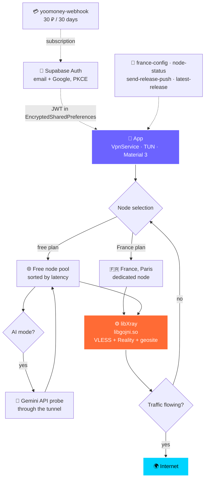

<p align="center">
  
</p>

<p align="center">
  
</p>

<p align="center">
  <b>A native Android VPN built on VLESS + Reality: traffic is indistinguishable from ordinary HTTPS, the tunnel comes up in one tap, and there is no advertising in the app at all.</b>
</p>

<p align="center">
  <a href="https://github.com/Core-Dev-Support/naua-security-mirage-android/releases/latest"></a>
  <a href="https://github.com/Core-Dev-Support/naua-security-mirage-android/actions/workflows/build-release.yml"></a>
  
  
</p>

<p align="center">
  
  
  
  
  
  
  
</p>

<p align="center">
  <a href="https://github.com/Core-Dev-Support/naua-security-mirage-android/releases/latest"></a>
  &nbsp;&nbsp;
  <a href="https://t.me/News_And_Updates_Apps"></a>
  &nbsp;&nbsp;
  <a href="README.md"></a>
</p>

<p align="center">
  <sub>Latest release: <b>v1.3.0</b> · <code>main</code> is on <b>v1.4.0</b> · Android 6.0+ · <code>arm64-v8a</code> / <code>armeabi-v7a</code></sub>
</p>

---

## What's inside

One big button, and the tunnel is up. There is no location to pick: the client measures latency to every available node, starts the Xray core on the best one, and then checks that traffic actually flows rather than trusting a successful core start. If the chosen node does not hold up, it fails over to the next one automatically.

**🛡 Masquerade.** VLESS + Reality: the connection is indistinguishable from a normal TLS session to a popular site, so it survives DPI where fingerprinted protocols fail.

**🤖 AI mode** · *v1.4.0*. A candidate node is probed with a Gemini API request through its own tunnel: exit country alone does not mean Google actually answers.

**⚡ Split-tunneling.** Per-App Proxy, your own domains direct, and all of `.ru` outside the tunnel at full speed.

**🧭 Guarded start.** The app does not launch on a tampered signature, a rooted device, an emulator, with a debugger attached, or with Frida present.

**🔒 DNS stays inside.** Plus a warning card when system Private DNS would break routing.

**🔄 In-app updates.** Download and install with mandatory v2/v3 signature verification — a foreign signature cancels the install.

**📴 Screen protection.** `FLAG_SECURE`, plus a dialog explaining the risk if you really need to capture the screen.

**🧩 Your own panel.** Themes, 5 button styles, animation controls, hide and reorder sections, Russian and English.

---

## 📱 Screens

<p align="center">
  <table>
    <tr>
      <td align="center"><br /><sub><b>Home</b><br />connect and status</sub></td>
      <td align="center"><br /><sub><b>Settings</b><br />tiles · Kill Switch · autostart</sub></td>
      <td align="center"><br /><sub><b>Split-tunneling</b><br />.ru · apps · sites</sub></td>
      <td align="center"><br /><sub><b>Appearance</b><br />themes · background · button</sub></td>
    </tr>
    <tr>
      <td align="center"><br /><sub><b>Colors</b><br />button · text · switches</sub></td>
      <td align="center"><br /><sub><b>Diagnostics</b><br />speed · autoping · nodes</sub></td>
      <td align="center"><br /><sub><b>Journal</b><br />levels · export · share</sub></td>
      <td align="center"><b>407 strings</b><br /><sub>Russian and English,<br />switched at runtime</sub></td>
    </tr>
  </table>
</p>

---

## 🔬 How it works



1. **Node selection.** Latency is measured across all candidates, the core is started on the best one, and actual traffic flow is then verified. If it does not hold, the next node is taken.
2. **AI mode** *(v1.4.0)*. A Gemini API request is additionally issued through the established tunnel. A node that yields no real Google access is rejected regardless of its exit country.
3. **Integrity.** On start the APK signing certificate is hashed with SHA-256 and compared against a value compiled into the binary; debugger attachment, `TracerPid`, hooking frameworks, Frida, root and emulator are all checked.
4. **Routing.** DNS stays inside the tunnel, while `geosite.dat` sends `.ru` and the domains you picked straight out.
5. **Control.** Speed, latency and session time appear on screen and in the notification; paid-node state and outage history live in the diagnostics card; background workers watch updates, the subscription and node availability.

Details: [docs/ARCHITECTURE.md](docs/ARCHITECTURE.md).

---

## 🧱 Stack

<p align="center">
  
  
  
  
  
  
  
  
  
</p>

- **Client** — Kotlin, `VpnService` (TUN, `specialUse` FGS), 2 Quick Settings tiles, WorkManager, OkHttp, `EncryptedSharedPreferences`.
- **Core** — Xray (`libgojni.so`, `arm64-v8a` + `armeabi-v7a`), VLESS + Reality, `geosite.dat` in assets with in-app updates.
- **Backend** — Supabase Auth (email + Google, PKCE) and 6 Deno Edge functions: `france-config`, `latest-release`, `node-status`, `register-device`, `send-release-push`, `yoomoney-webhook`.
- **CI/CD** — secret-scan → `deno check` and `deno test` → 9 unit tests → R8 build → manifest check for advertising identifiers → v2/v3 signature requirement.

---

## 🚀 Install

1. Open [**Releases → Latest**](https://github.com/Core-Dev-Support/naua-security-mirage-android/releases/latest).
2. Download `NAUA-Security-Mirage-v1.3.0.apk` (≈ 28 MB).
3. Allow installation from unknown sources and install the package.
4. Tap the big button.

**Requirements:** Android 6.0+ (API 23), `arm64-v8a` or `armeabi-v7a`, any internet connection.

<details>
<summary><b>Subscribing to the dedicated France node</b></summary>

Sign in with email or Google, then choose YooMoney — **30 ₽ for 30 days**. One-time payment, no auto-renewals. The node activates within 1–2 minutes. The subscription is bound to your account, not to a device.

</details>

<details>
<summary><b>How to verify the tunnel really works</b></summary>

The app has a node card with an "N of M responding" check, an outage history for the paid node, and a live speed panel. Independent check: open [ipleak.net](https://ipleak.net) or [dnsleaktest.com](https://dnsleaktest.com) in a browser while connected — you should see the node's IP and DNS, not your provider's.

</details>

---

## 🔨 Build from source

Requires **JDK 17** and the **Android SDK (API 34+)**:

```bash
git clone https://github.com/Core-Dev-Support/naua-security-mirage-android.git
cd naua-security-mirage-android

./gradlew assembleDebug          # debug build
./gradlew testDebugUnitTest      # unit tests
./gradlew assembleRelease        # release build with R8
```

Secrets (`SUPABASE_URL`, `FRANCE_*`, `YOOMONEY_WALLET` and the rest) are read from `local.properties`, environment variables or Gradle properties and **never end up in code**. The signing key is `mirage-release.jks`. `*.jks`, `key.properties`, `google-services.json` and `local.properties` are not committed.

CI builds the signed APK, verifies release file digests, requires a v2 or v3 signature, checks that the merged manifest carries no `AD_ID` or ad permissions, and only then publishes the Release.

---

## 📁 Layout

```
naua-security-mirage-android/
├── app/                     Android client
│   └── src/main/
│       ├── java/com/naua_security_mirage/app/
│       │   ├── ui/          MainActivity, adapters, custom views
│       │   ├── vpn/         MirageVpnService, XrayVpnController, tiles
│       │   ├── data/        Supabase, repositories, models
│       │   ├── util/        AppShield, updates, logging, animations
│       │   ├── work/        WorkManager: node, subscription, updates
│       │   └── push/        FCM receiver
│       ├── jniLibs/         libgojni.so — arm64-v8a, armeabi-v7a
│       ├── assets/geo/      geosite.dat
│       └── test/            9 unit tests
├── desktop/                 Compose Multiplatform client (work in progress)
├── supabase/functions/      6 Deno Edge functions
├── docs/                    Architecture, releases, legal, screenshots
└── .github/workflows/       build-release, secret-scan, live-check, build-desktop
```

---

## 🛡 Security and privacy

- **No traffic logs.** Visited sites, DNS queries and packet contents are neither collected nor stored.
- **Minimal permissions.** No `QUERY_ALL_PACKAGES` — the app list comes from targeted `<queries>`. `AD_ID`, `ACCESS_ADSERVICES_*` and the referrer service are stripped from the manifest, and CI verifies this before publishing.
- **Tokens** live in `EncryptedSharedPreferences`, app backup is disabled (`allowBackup=false`) and cleartext traffic is denied (`usesCleartextTraffic=false`).
- **Guarded start.** APK signature, debugger, `TracerPid`, hooking frameworks, Frida, root and emulator are checked on launch. A forged build does not run.
- **Updates** only install when the v2/v3 signature matches.
- **Telemetry** is anonymous Firebase crash and usage data, switched off with a single toggle; traffic content is never sent.
- **No secrets in the repository.** CI fails if a host, password or key is found in source.

Found a vulnerability? Do not open a public issue — see [SECURITY.md](SECURITY.md).

---

## 📋 Releases

| Version | Status | Highlights |
| :--- | :--- | :--- |
| **v1.4.0** | in development | AI mode with a real Gemini probe · animation controls · hide and reorder settings sections · payment reminders with a tile · donations via CloudTips and Tribute · node outage journal |
| **v1.3.0** | released | Google sign-in · YooMoney subscription at 30 ₽ · dedicated France node · screenshot protection · tunnel logs · free-mode DNS fixes |

Release notes: [docs/releases/](docs/releases/). Full history: [CHANGELOG.md](CHANGELOG.md). Plans: [ROADMAP.md](ROADMAP.md).

---

## ❓ FAQ

<details>
<summary><b>Is it free?</b></summary>

Yes, there is a free mode on a pool of free nodes. The dedicated France node costs a one-time **30 ₽ for 30 days**, with no auto-renewals.

</details>

<details>
<summary><b>What is AI mode?</b></summary>

A node-selection mode that checks for a **real response from Google** through the tunnel itself instead of trusting the exit country. If no node qualifies, the app says so plainly rather than connecting blindly.

</details>

<details>
<summary><b>Why do banking and government sites work without the VPN?</b></summary>

Split-tunneling: `.ru` sites and the apps and domains you selected go direct, everything else goes through the tunnel.

</details>

<details>
<summary><b>What do you see?</b></summary>

No URLs, no DNS, no traffic content. Strict No-Logs at the application level, and the advertising identifier is stripped from the manifest.

</details>

<details>
<summary><b>Why does Android ask me to disable another VPN?</b></summary>

The system allows only one active VPN at a time. That is an Android limitation, not an app one.

</details>

<details>
<summary><b>Will it be in app stores?</b></summary>

Currently GitHub Releases, from which the app updates itself with signature verification. Uptodown is under review.

</details>

---

## 🤝 Contributing

- ⭐ A star is the best support this project can get.
- 🐛 Found a bug? — [bug report](https://github.com/Core-Dev-Support/naua-security-mirage-android/issues/new/choose).
- 💡 Have an idea? — [feature request](https://github.com/Core-Dev-Support/naua-security-mirage-android/issues/new/choose).
- 🔧 Want to send code? — [CONTRIBUTING.md](CONTRIBUTING.md); PR and issue templates are already configured.
- 📣 [Telegram channel for updates](https://t.me/News_And_Updates_Apps).

---

## 📜 License

The source is available for review, testing and **independent security audit**. All rights to the **NAUA Security Mirage** brand, design, graphics and code belong to **Core Dev Support**. Full terms: [LICENSE](LICENSE).

<p align="center">
  <a href="https://github.com/Core-Dev-Support/naua-security-mirage-android/releases/latest"><b>⬇️ Download APK</b></a>
  &nbsp;•&nbsp;
  <a href="mailto:coredevsupport@gmail.com">coredevsupport@gmail.com</a>
  &nbsp;•&nbsp;
  <a href="https://t.me/News_And_Updates_Apps">Telegram</a>
</p>