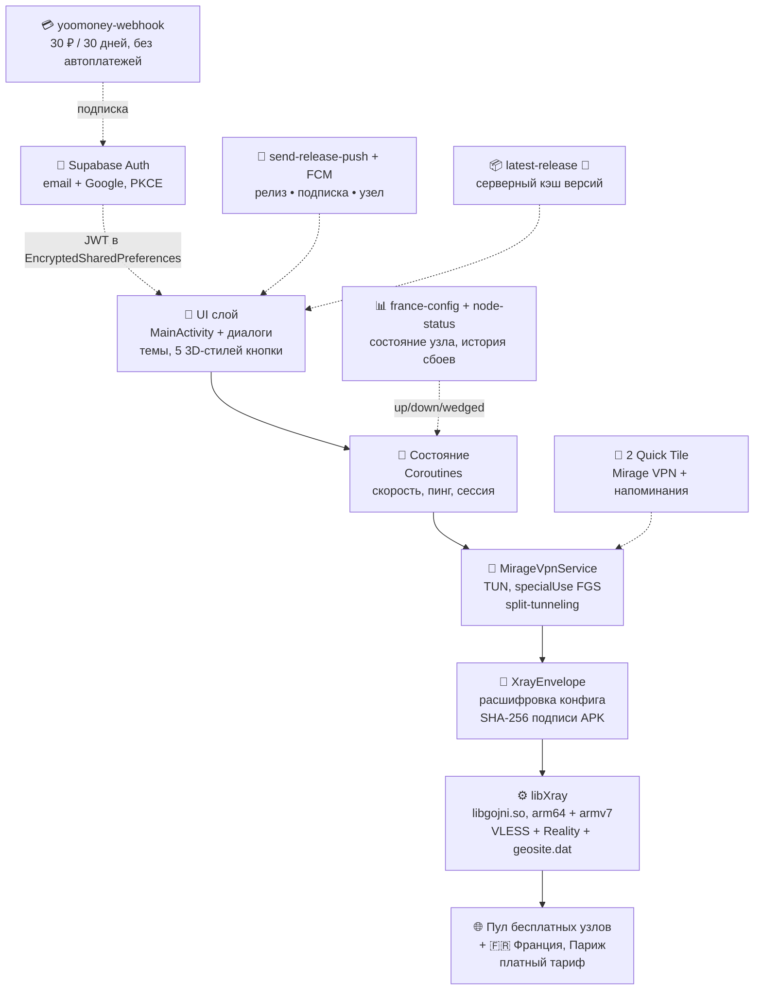

# Архитектура NAUA Security Mirage

Короткая карта того, как устроено приложение, для контрибьюторов и аудиторов безопасности.
Соответствует коду в `main` (готовится v1.4.0; последний стабильный релиз — v1.3.0).

## Компоненты

## Ключевые решения

| Решение | Почему |
| :--- | :--- |
| VLESS + Reality, маскировка под HTTPS | устойчивость к DPI, низкий оверхед |
| Автовыбор сервера + AI-режим (реальный доступ к Google) | пользователю не нужна «выбор локации»; 🧪 в 1.4.0 плюс потери/джиттер |
| `XrayEnvelope` + проверка SHA-256 релизного ключа | перепакованный APK не расшифрует конфиг |
| DNS строго внутри туннеля + детектор системного Private DNS | ноль DNS-утечек, предупреждение о конфликте |
| Самообновление с проверкой подписи (чужой/битый пакет — отмена) | безопасные обновления без сторов |
| 🧪 Версии через серверный кэш, а не GitHub API напрямую | нет лимитов и «повторите позже» |
| `FLAG_SECURE` + диалог о рисках | защита от скриншотов/записи экрана |
| Нет `QUERY_ALL_PACKAGES` (точечный `<queries>`), AD_ID вырезан | минимум данных и трекеров |
| Телеметрия отключаема в 1 клик | приватность по умолчанию + право на opt-out |

## Потоки данных

- **Трафик:** App → TUN → libXray (VLESS+Reality) → автовыбранный узел → Интернет. Провайдер видит только TLS-сессию.
- **Аккаунт:** Supabase Auth (email / Google, PKCE через `mirage://auth/callback`) → JWT локально → привязка подписки.
- **Оплата:** ЮMoney-форма → `yoomoney-webhook` → Supabase → +30 дней; колбэк — `mirage://payment/success`. Реквизиты карт не касаются приложения.
- **Обновления:** GitHub Release → (🧪 `latest-release`-кэш) → диалог в приложении → скачивание → проверка подписи → установка (`REQUEST_INSTALL_PACKAGES` только для своих обновлений).

## CI/CD

`secret-scan` (ноль секретов в коде) → `deno check/test` (edge-функции) → `testDebugUnitTest` (9 файлов:
XrayEnvelope, HandoverPolicy, PrivateDns, подписки, OAuth/PKCE, VlessServer) →
`assembleRelease` (R8) → проверка merged-манифеста (без AD_ID) → проверка подписи v2/v3 →
публикация Release (тело — из `docs/releases/<tag>.md`) + push-уведомление.

## Где что лежит

| Путь | Назначение |
| :--- | :--- |
| `app/src/main/java/.../app/ui/` | MainActivity, диалоги: auth, подписка, обновления, поддержка |
| `app/src/main/java/.../app/vpn/` | MirageVpnService, XrayEnvelope, HandoverPolicy, AiRegionBlock, 2 Tile-сервиса |
| `app/src/main/java/.../app/work/` | Воркеры: UpdateCheck, SubscriptionExpiry, NodeStatus (+ нотифаеры) |
| `app/src/main/java/.../app/data/` | Supabase Auth/репозитории, модель VlessServer |
| `app/src/main/jniLibs/` | `libgojni.so` только для `arm64-v8a` + `armeabi-v7a` |
| `app/src/main/assets/geo/` | `geosite.dat` для split-tunneling (+ обновление гео-баз из приложения) |
| `app/src/test/` | 9 юнит-тестов |
| `supabase/functions/` | `france-config`, `latest-release` 🧪, `node-status`, `register-device`, `send-release-push`, `upload-logs`, `yoomoney-webhook` |
| `desktop/` | Заготовка десктоп-клиента (Compose Multiplatform) + `Core/` (xray.exe, wintun.dll, geoip/geosite) |
| `.github/workflows/` | `build-release.yml`, `secret-scan.yml`, `live-check.yml`, `build-desktop.yml` |
| `docs/releases/` | Заметки к релизам — источник правды для GitHub Releases |
| `docs/legal/` | Privacy Policy + Terms (MD + TXT) |
