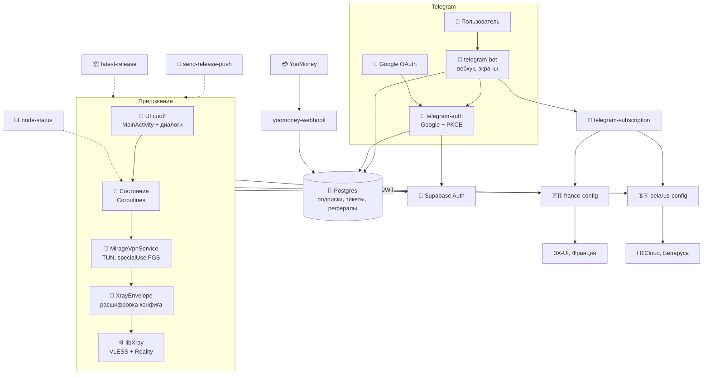

# Архитектура NAUA Security Mirage

Карта того, как устроены приложение и его серверная часть, для контрибьюторов
и аудиторов безопасности. Соответствует коду в `main` (v1.4.0).

Отдельного бэкенда нет: Postgres, Auth и Edge Functions живут в одном проекте
Supabase (`orwwaptbxmwxvfwfqavc`). Vercel не используется — вебхук Telegram
смотрит прямо на Edge Function.

## Компоненты



## Единый аккаунт: бот и приложение

Google-аккаунт — одна личность на оба продукта:

- **В боте:** «Войти через Google» → `telegram-auth` обменивает код на сессию
  Supabase (PKCE) и пишет привязку `tg_id` ↔ `auth.users.id` в
  `telegram_accounts`. Сессия сохраняется в той же строке: бот запрашивает
  платные узлы от `france-config` и `belarus-config`, а они требуют
  пользовательский JWT.
- **В приложении:** тот же Google-вход (PKCE через `mirage://auth/callback`) →
  тот же `auth.users.id` → та же строка `subscriptions`. Поэтому оплата,
  сделанная в боте, видна в приложении, и наоборот.

Строка `subscriptions` — единственный источник правды о сроке подписки. Её
обновляют: `telegram-auth` (привязка и пробник), `yoomoney-webhook` (оплата и
реферальный бонус), админские команды бота.

## Telegram-бот

Вебхук `telegram-bot` принимает апдейты Telegram (заголовок
`X-Telegram-Bot-Api-Secret-Token`), читает и пишет данные service-role ключом.
Подробное описание экранов и текстов — в
[docs/telegram-bot.md](telegram-bot.md).

### Один экран на чат

У каждого пользователя в `bot_users.screen_message_id` хранится id сообщения,
которое бот **переписывает** (`editMessageText`) при каждом действии. Новых
пузырей не появляется: приветствие превращается в подтверждение входа, меню —
в профиль, профиль — в поддержку.

Если сообщение недоступно (удалено, старше 48 часов, принадлежит другому чату),
бот создаёт новое, запоминает его id и удаляет старый пузырь — чат не остаётся
без экрана. Вне этого правила — только вложения поддержки, уведомления админу и
ответ администратора пользователю.

### Ворота

Пока Google-аккаунт не привязан, доступно только приветствие: вход и смена
языка. Меню, профиль, поддержка, рефералка и подключение закрыты — вместо них
бот снова показывает приветствие. Исключений для админа нет.

### Экраны

| Экран | Что делает |
|---|---|
| Язык | RU/EN одним сообщением, выбор сохраняется в `bot_users.lang` |
| Приветствие | что это за бот, кнопка входа (ссылка генерируется заранее) |
| После входа | подтверждение + главное меню одним экраном |
| Главное меню | подключиться, профиль, поддержка, подписка, рефералка, приложение, благодарность, настройки, админка |
| Подключение | одна ссылка на узлы + кнопка копирования (`copy_text`) |
| Подписка | что входит, статус, тарифы, оплата, «Я оплатил» |
| Профиль | статус, Google-аккаунт, дата регистрации, рефералы, платежи, документы |
| Поддержка | заявки с вложениями и перепиской — один пузырь на весь флоу |
| Рефералка | ссылка, приглашённые, прогресс до вехи |
| Настройки | язык, выход из Google, документы |
| Благодарность | CloudTips и Tribute — три способа |

Тексты — в `lib/i18n.ts` (131 ключ на RU и EN, `t(lang, key, vars)`);
если перевода нет, берётся русский. Тесты проверяют полноту словарей,
двойные эмодзи/`<b>` и вложенные теги.

### Скорость

Контекст пользователя (профиль, привязка, подписка, рефералы, платежи)
собирается **одним** RPC-вызовом `bot_context(tg_id)` на стороне Postgres, а не
шестью запросами подряд. Результат кэшируется на 5 секунд; кнопка «Я оплатил»
читает базу принудительно. Ответ на callback уходит параллельно с загрузкой
данных. Подробности и замеры — в [docs/telegram-bot.md](telegram-bot.md).

### Подписка, оплата, рефералка

- Тарифы и каталог платных узлов живут в `public.app_config`; приложение
  читает их через `app-config`, бот — напрямую service-role клиентом, вебхук —
  оттуда же при каждой оплате. Встроенные списки в `plans.ts` и `contract.ts`
  остались только запасным вариантом на случай недоступности таблицы.
- `label` платежа — `<auth.users.id>:<дней>`. Вебхук проверяет подпись
  YooMoney, сумму и срок, начисляет дни и продлевает клиента в 3X-UI. Старые
  ссылки без срока продолжают приниматься по сумме.
- Рефералка: +2 дня пригласившему после первой оплаты приглашённого и +10 дней
  каждые 5 оплативших. Повторное начисление за того же реферала блокируется
  записью `outcome='referral_bonus'` в `payment_events`.
- Пробник: 1 день каждому, у кого подписки ещё не было (`telegram-auth/lib/trial.ts`).
- Кнопка «Открыть подписку» ведёт на статическую страницу (`docs/connect`):
  Telegram не пропускает `happ://` в кнопках, а прямая ссылка подписки
  отдаётся как `text/plain` и скачивается файлом. На странице — кнопки Happ,
  Hiddify, v2rayTun и копирование ссылки.

### Поддержка

Заявка — это тред: `tickets` (текст, статус, вложение) и `ticket_messages`
(переписка, `from_user`). Пользователь пишет прямо в чат, подтверждает отправку
в том же пузыре, видит ответы админа и может отвечать. Ответ приходит с
кнопками «Ответить» и «Закрыть»: закрытие помечает заявку решённой и
уведомляет админа. Админу уходит id, `@username`, Google-аккаунт и ссылка на
строку в панели. Вложения копируются в чат админа (`copyMessage`), при
неудаче — кнопка «Показать файл».

### Крон

`POST ?op=cron` с заголовком `x-sub-key` (`SUB_SECRET` или `CRON_KEY`):
напоминания об истечении подписки (за 3 дня, завтра, сегодня), чистка
протухших `bot_state`/`telegram_oauth_attempts` и продвижение рассылки.

Расписание — в базе через `pg_cron` + `pg_net`, каждые 15 минут
(миграция `20261029000000_subscription_notifications_cron.sql`):

```sql
select cron.schedule(
  'telegram-bot-cron',
  '*/15 * * * *',
  $job$
  select net.http_post(
    url := 'https://<ref>.supabase.co/functions/v1/telegram-bot?op=cron',
    headers := jsonb_build_object(
      'Content-Type', 'application/json',
      'x-sub-key', (
        select decrypted_secret from vault.decrypted_secrets
        where name = 'telegram_bot_cron_key'
      )
    ),
    body := '{}'::jsonb,
    timeout_milliseconds := 30000
  );
  $job$
);
```

Ключ `CRON_KEY` лежит в Vault (`telegram_bot_cron_key`), в репозитории его нет.
Отдельный ключ нужен, чтобы не менять `SUB_SECRET` внешнего крона.
Напоминание уходит один раз в сутки на пользователя (`bot_users.last_notified`).

## Edge Functions

| Функция | Кто вызывает | Доступ | Назначение |
|---|---|---|---|
| `telegram-bot` | Telegram | секрет вебхука | Экраны, подписка, поддержка, рефералка, админка, крон |
| `telegram-auth` | браузер, бот | публичный GET; `start`/`status` — только с `x-bot-secret` | Google-вход, привязка, пробник, экран ошибки |
| `telegram-subscription` | VPN-клиент, приложение | подпись `tg_id` (с версией ссылки) или JWT | Одна base64-ссылка: все узлы из `app_config.paid_nodes` (+ бесплатный обход по подписанной `?free=…`, только Happ) |
| `yoomoney-webhook` | YooMoney | подпись YooMoney | Начисление дней, реферальный бонус, журнал платежей |
| `france-config` | приложение | JWT пользователя | Узел 3X-UI для оплатившего |
| `belarus-config` | приложение | JWT пользователя | Узел H1Cloud для оплатившего |
| `finland-config` | приложение, `telegram-subscription` | JWT пользователя | Заготовка VLESS-узла; в живом каталоге не включена |
| `register-device` | приложение | без JWT; при наличии JWT привязывает токен к аккаунту | Токен FCM для пушей |
| `send-release-push` | CI | `x-push-secret` | Пуш о релизе |
| `latest-release` | приложение | публичный | Кэш версий поверх GitHub Releases |
| `node-status` | приложение, watchdog | чтение по anon-ключу (без `detail`), запись по `x-node-token` | Состояние узлов и история сбоев |

`telegram-auth?action=start` принимает `tg_id` из URL, поэтому бот передаёт
`x-bot-secret` (`BOT_INTERNAL_SECRET`). Без него любой мог бы выписать ссылку
входа для чужого Telegram. `action=status` закрыт тем же заголовком: иначе по
`tg_id` раскрывался email привязки.

`france-config` и `belarus-config` не отдают узлы без валидной сессии и без
`paid_until` в будущем: запись `is_active=true` с пустым сроком больше не
открывает платный узел. `telegram-subscription` принимает либо
`?user=<tg_id>_<HMAC>`, либо `Authorization: Bearer <JWT>`. Подпись не
подставляется публичным значением по умолчанию: без `SUBSCRIPTION_SECRET`
функция падает, а не выдаёт подделываемые ссылки.

`belarus-config` запоминает имя клиента в `subscriptions.belarus_client_name`.
H1Cloud иногда отвечает `409 name_taken_by_inbound_client` на имя, которого нет
в `/clients`; функция выбирает первый свободный суффикс `_v2…_v6` и дальше
работает с ним, не сканируя панель заново. Срок клиента продлевается до
`paid_until`, если панель отстала от подписки.

Платные узлы приложения тоже серверные. `app_config.paid_nodes` содержит
`id`, `kind` (`france`, `belarus` или `vless`), подписи, флаг и
`config_function`. Приложение рисует кнопки из этого списка; для `vless`
вызывает указанную функцию и разбирает обычную VLESS-ссылку. Добавление
Финляндии — запись в таблице плюс задеплоенная `finland-config`; удаление или
`enabled: false` убирает кнопку. Пересборка APK не нужна, пока новый узел
говорит на VLESS с тем же форматом ссылки.

Новый узел добавляется одной строкой в `app_config.paid_nodes`:

```sql
update public.app_config
set payload = payload || jsonb_build_array(jsonb_build_object(
  'id', 'premium_finland',
  'kind', 'vless',
  'label_ru', 'Финляндия (Платная)',
  'label_en', 'Finland (Paid)',
  'flag', 'finland',
  'config_function', 'finland-config',
  'enabled', true,
  'sort', 30
))
where id = 'paid_nodes';
```

`finland-config` принимает пользовательский JWT и возвращает
`{"vlessKey": "vless://…", "clientUuid": "…"}` — как `france-config`. Если узел
на другом протоколе (WireGuard, Shadowsocks, Trojan), приложение его не
разберёт без обновления.

Пока реальной финской панели нет, `finland-config` работает в режиме
`source=france-fallback`: берёт панель и адрес Франции, но остаётся отдельной
функцией со своим кэшем ключа по `node.id`. Это позволяет проверить весь
серверный путь (кнопка → `config_function` → VLESS-ключ → туннель) без
пересборки APK. Когда появится финская панель, достаточно задать секреты
`FINLAND_3X_UI_*` и `FINLAND_*` (`HOST`, `PORT`, `PBK`, `SNI`); код приложения
и `app_config` менять не нужно.

Каждая выдача ключа пишет в лог функции одну JSON-строку с `fn`, `node`,
`source` и `event` (`authorized`, `key-issued`, `denied`, `failed`), без самого
ключа, UUID и адреса панели. В приложении тот же путь виден по строкам
`Ключ узла premium_finland_test выдан finland-config` и
`Выбран платный узел: Финляндия (Тест)`.

Тестовый узел `premium_finland_test` удалён из живого `app_config.paid_nodes`
после успешной проверки: кнопка исчезает из приложения и из ссылки подписки.
Функция `finland-config` остаётся задеплоенной заготовкой; чтобы вернуть узел,
достаточно снова добавить запись в каталог.

`node-status` собирает серверную историю только по Франции. Беларусь
проверяется с устройства, потому что её доступность зависит от сети; переходы
`up/down` пишутся локально (`NodeEventStore`) и показываются в карточке
диагностики вместе с причиной (`ключ не получен`, `не отвечал`, `туннель не
поднялся`).

Права `public` выдаются явно: у `subscriptions` — только `SELECT` для
`authenticated` (RLS `auth.uid() = user_id`); `anon` не читает таблицу. Для
новых объектов `anon`/`authenticated` больше не получают права по умолчанию —
это закреплено миграцией `20261101000000_tighten_public_privileges.sql`.

## Схема данных

### Общие

| Таблица | Назначение |
|---|---|
| `subscriptions` | Срок и узлы подписки; ключ — `auth.users.id` |
| `app_config` | Тарифы и каталог платных узлов; читает `app-config` |
| `auth.users` | Google-аккаунты (Supabase Auth) |

### Бот

Миграции — `supabase/migrations/2026102000000*.sql`.

| Таблица | Назначение |
|---|---|
| `telegram_accounts` | Привязка `tg_id` ↔ `auth.users.id` + сессия Supabase |
| `telegram_oauth_attempts` | Незавершённые попытки входа (state + PKCE, 10 минут) |
| `bot_users` | Профиль: язык, бан, варны, реферер, id экрана |
| `bot_state` | Состояние диалогов и очередь рассылки |
| `tickets` | Заявки поддержки |
| `ticket_messages` | Переписка по заявке |
| `payment_events` | Журнал оплат и реферальных бонусов |
| `admin_logs` | Действия администратора |
| `device_tokens` | Push-устройства приложения (`user_id`, версия, последняя активность) |

Границы доступа:

- все таблицы бота — RLS **без политик** и без привилегий у `anon` и
  `authenticated`: их видит только service-role;
- `subscriptions` — единственная таблица с политикой
  `subscriptions_select_own` (`auth.uid()::text = user_id`): приложение читает
  только свою строку;
- `bot_context` — RPC, доступная только `service_role`.

## Потоки данных

- **Трафик:** App → TUN → libXray (VLESS+Reality) → узел → Интернет.
  Провайдер видит только TLS-сессию.
- **Вход:** Google → Supabase Auth (PKCE) → `telegram-auth` (бот) или
  `mirage://auth/callback` (приложение) → `telegram_accounts` /
  `subscriptions` → JWT локально.
- **Оплата:** форма YooMoney → `yoomoney-webhook` → `subscriptions` (+ дни) →
  `payment_events` → при необходимости бонус пригласившему.
- **Пробник:** первый вход через Google и пустая подписка → `plan='trial'`,
  `paid_until = now + 1 день`.
- **Обновления:** GitHub Release → `latest-release` → диалог в приложении →
  проверка подписи APK → установка.

## Деплой и проверки

```bash
# публичные функции: шлюз не должен требовать JWT
npx supabase functions deploy telegram-bot --project-ref <ref> --no-verify-jwt
npx supabase functions deploy telegram-auth --project-ref <ref> --no-verify-jwt
npx supabase functions deploy yoomoney-webhook --project-ref <ref> --no-verify-jwt
npx supabase functions deploy telegram-subscription --project-ref <ref> --no-verify-jwt
npx supabase functions deploy app-config --project-ref <ref> --no-verify-jwt

# функции приложения проверяют сессию сами (auth.getUser)
npx supabase functions deploy france-config --project-ref <ref>
npx supabase functions deploy belarus-config --project-ref <ref>

# типы и тесты — те же команды, что в CI
deno check supabase/functions/telegram-bot/index.ts
deno test --allow-read --allow-env \
  supabase/functions/telegram-bot/lib/i18n_test.ts \
  supabase/functions/telegram-bot/lib/plans_test.ts \
  supabase/functions/telegram-bot/lib/telegram_test.ts \
  supabase/functions/telegram-bot/lib/referral_test.ts \
  supabase/functions/telegram-auth/lib/trial_test.ts
```

Секреты — только в окружении Supabase: `TELEGRAM_TOKEN`,
`TELEGRAM_SECRET_TOKEN`, `ADMIN_ID`, `BOT_USERNAME`, `SUPABASE_*`,
`YOOMONEY_WALLET`, `YOOMONEY_SECRET`, `SUBSCRIPTION_SECRET`, `SUB_SECRET`,
`BOT_INTERNAL_SECRET`, `CRON_KEY`, `THREE_X_UI_*`, `H1CLOUD_*`, `PUSH_SEND_SECRET`,
`NODE_STATUS_TOKEN`.

## CI/CD

`secret-scan` (ноль секретов в коде) → `deno check/test/lint` (Edge-функции) →
`testDebugUnitTest` (приложение) → `assembleRelease` (R8) → проверка
merged-манифеста (без AD_ID) → проверка подписи v2/v3 → публикация Release
(тело — из `docs/releases/<tag>.md`) + пуш-уведомление.

## Где что лежит

| Путь | Назначение |
|---|---|
| `app/src/main/java/.../app/ui/` | MainActivity, диалоги: auth, подписка, обновления, поддержка |
| `app/src/main/java/.../app/vpn/` | MirageVpnService, XrayEnvelope, HandoverPolicy, AiRegionBlock, Tile-сервисы |
| `app/src/main/java/.../app/work/` | Воркеры: UpdateCheck, SubscriptionExpiry, NodeStatus |
| `app/src/main/java/.../app/data/` | Supabase Auth/репозитории, модель VlessServer |
| `app/src/main/jniLibs/` | `libgojni.so` для `arm64-v8a` и `armeabi-v7a` |
| `app/src/test/` | Юнит-тесты приложения |
| `supabase/functions/telegram-bot/` | Бот: `index.ts` + `lib/` (i18n, plans, referral, store, telegram, subscription) |
| `supabase/functions/app-config/` | Публичные тарифы и каталог платных узлов из `app_config` |
| `supabase/functions/telegram-auth/` | Google-вход + `lib/trial.ts` |
| `supabase/functions/telegram-subscription/` | Сборка единой ссылки из двух хостеров |
| `supabase/functions/yoomoney-webhook/` | Оплата + `contract.ts` (тарифы и правила рефералки) |
| `supabase/functions/{france,belarus}-config/` | Выдача узлов по JWT |
| `supabase/migrations/` | Схема, RLS и RPC |
| `docs/telegram-bot.md` | Экраны, тексты, флоу бота |
| `docs/connect/` | Страница подключения (Happ/Hiddify/v2rayTun) для GitHub Pages |
| `docs/releases/` | Заметки к релизам |
| `.github/workflows/` | `build-release.yml`, `secret-scan.yml`, `live-check.yml` |
